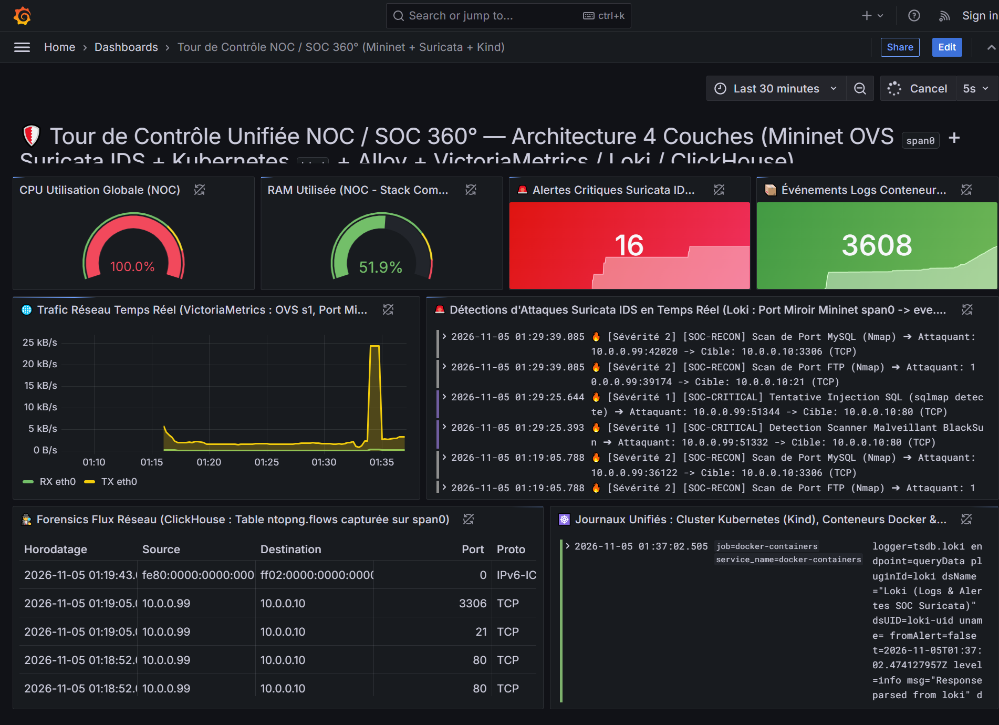
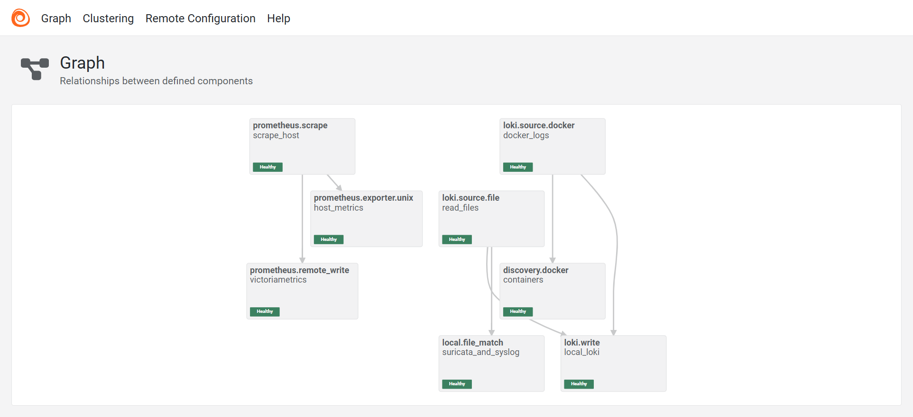
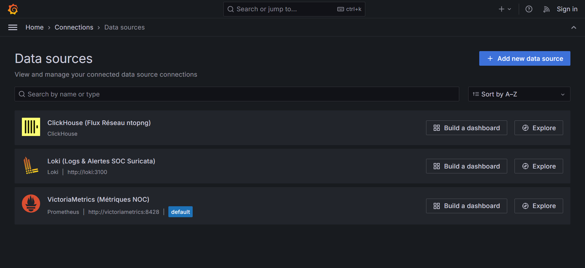
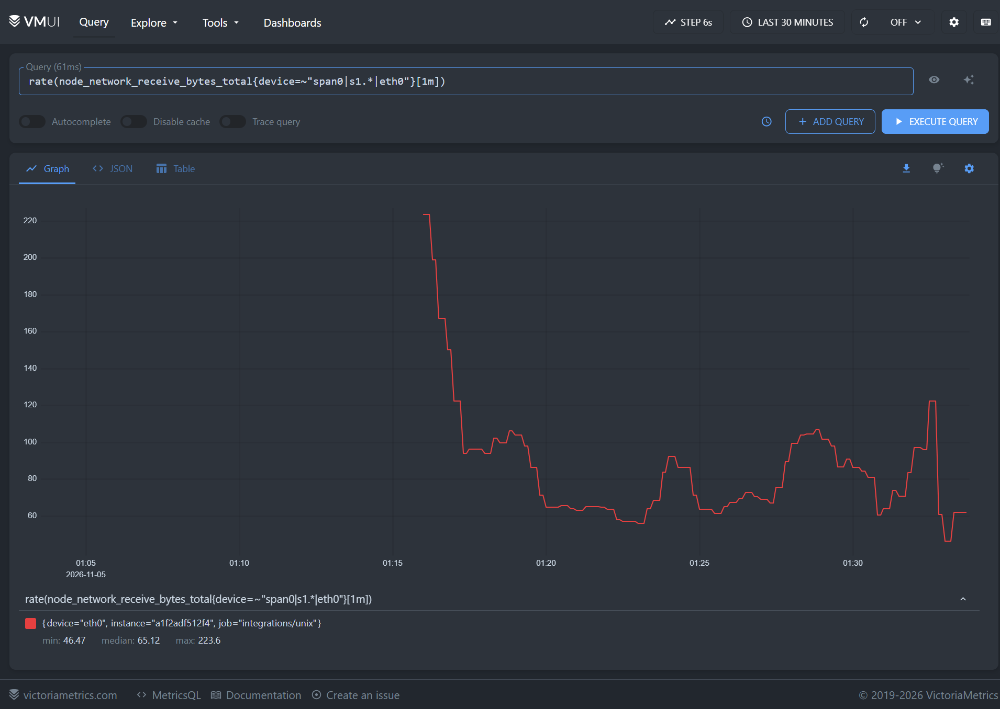
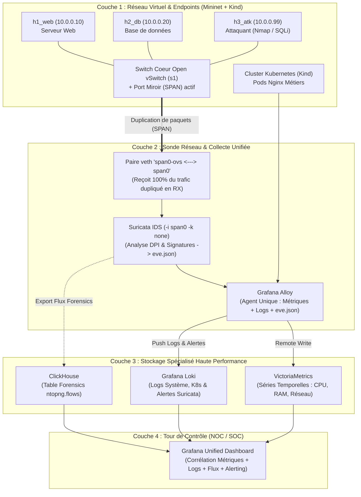
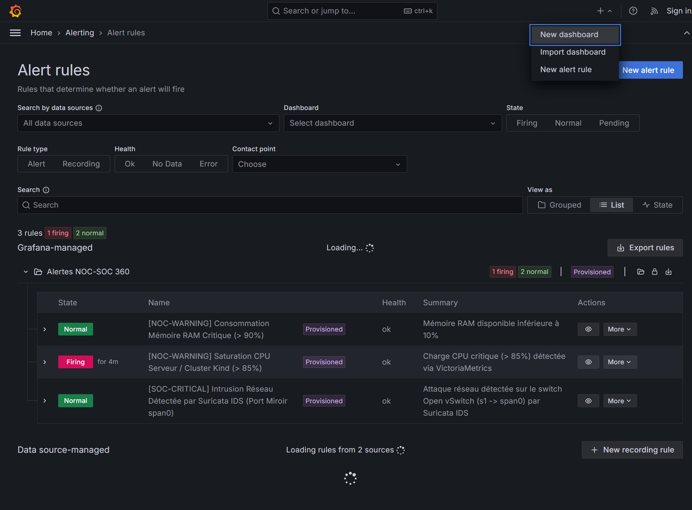

# 🛡️ Architecture de Référence NOC/SOC 360° — Labo Complet (Mininet + Kind + Suricata + Grafana Stack)

Ce dépôt contient l'implémentation complète, pédagogique et validée en conditions réelles d'une architecture **NOC (Network Operations Center)** et **SOC (Security Operations Center)** moderne en **4 couches**.

Il a été conçu et optimisé pour tourner sur **une seule machine virtuelle Ubuntu (`NOC-SOC-360-Lab` dans VMware Workstation)** avec une empreinte mémoire totale de seulement **~1,5 Go de RAM**, en combinant :
* **Mininet & Open vSwitch (OVS)** pour simuler le réseau d'entreprise (`10.0.0.0/24`) et le **Port Mirroring (SPAN)** matériel via une paire `veth` (`span0-ovs <---> span0`).
* **Suricata (IDS)** pour la détection d'intrusions réseau en temps réel (DPI, injections SQL `sqlmap`, scanners `BlackSun`, reconnaissances `Nmap`) sur le port miroir `span0`.
* **Kind (Kubernetes in Docker)** pour héberger les microservices métiers conteneurisés (`intranet-web`).
* **Grafana Alloy + VictoriaMetrics + Loki + ClickHouse + Grafana** pour la collecte unifiée, le stockage haute performance et la corrélation visuelle à 360°.

---

## 📸 1. Résultats Visuels du Labo en Production (VMware Workstation)

### A. Tour de Contrôle Unifiée NOC / SOC 360° (Grafana)
Corrélation sur un seul écran des **4 piliers** :
1. **Métriques NOC (VictoriaMetrics) :** Gauges CPU/RAM et graphique temps réel du trafic réseau montrant le pic généré sur le switch Open vSwitch lors de l'attaque.
2. **Détection d'Intrusions SOC (Loki + Suricata `eve.json`) :** Compteur d'alertes critiques et flux temps réel des signatures interceptées sur le port miroir `span0` (`[SOC-CRITICAL] Tentative Injection SQL (sqlmap detecte)`, `Detection Scanner Malveillant BlackSun`, `Scan de Port MySQL/FTP Nmap`).
3. **Forensics Réseau (ClickHouse `ntopng.flows`) :** Table analytique SQL retraçant chaque connexion (`Source`, `Destination`, `Port`, `Protocole`, `DPI_L7`, `Octets`, `Qualification_SOC`).
4. **Cloud-Native Logs (Loki + Kubernetes `Kind`) :** Journaux unifiés des Pods Kubernetes et des conteneurs Docker.



---

### B. Pipeline de Collecte Unifié : Grafana Alloy (Remplace Telegraf + Promtail)
Interface graphique native de **Grafana Alloy** (`http://192.168.126.100:12345/graph`) montrant l'état `Healthy` des 3 pipelines parallèles (Métriques hôtes $\rightarrow$ VictoriaMetrics, Fichiers `eve.json`/Syslog $\rightarrow$ Loki, Conteneurs Docker/Kind $\rightarrow$ Loki) :



---

### C. Sources de Données Pré-Provisionnées & Moteur TSDB VictoriaMetrics
Les 3 bases de données spécialisées (**VictoriaMetrics**, **Loki**, **ClickHouse**) sont provisionnées automatiquement dès le démarrage de Grafana (aucune configuration manuelle requise) :



Vue directe dans **VictoriaMetrics VMUI** (`http://192.168.126.100:8428/vmui`) du débit réseau capturé :



---

## 🏗️ 2. Comprendre l'Architecture (Approche Pédagogique)



### 💡 Les 3 Points Techniques Clés Appris lors de l'Implémentation
1. **Pourquoi utiliser une paire `veth` (`span0-ovs <---> span0`) pour le Port Miroir OVS ?**
   Une sonde IDS comme Suricata (via `AF_PACKET`) capture les paquets qui **entrent (`RX`)** sur une carte réseau. Si l'on branche une simple interface `dummy` sur Open vSwitch, le noyau Linux jette les paquets en sortie (`TX`). En créant un cordon virtuel `veth` (`ip link add span0 type veth peer name span0-ovs`) et en branchant `span0-ovs` sur le switch `s1`, chaque paquet copié par le switch ressort à l'autre bout du câble dans `span0` en **réception (`RX`)**, exactement comme un vrai câble RJ45 branché sur le port SPAN d'un switch Cisco !
2. **Pourquoi l'option `-k none` sur Suricata est indispensable en environnement virtuel ?**
   Dans les *Network Namespaces* Linux (Mininet, Docker, Kubernetes), le calcul des sommes de contrôle TCP/UDP (*Checksums*) est différé par le noyau (*Checksum Offloading*). Sans l'option `-k none`, Suricata rejette les paquets HTTP/TCP internes en croyant que leur checksum est corrompu.
3. **Limite `IFNAMSIZ` du noyau Linux (15 caractères maximum) :**
   Sous Linux, le nom d'une interface réseau ne peut pas dépasser 15 octets. Dans Mininet, le nom de l'interface est construit sous la forme `<nom_hote>-eth0`. C'est pourquoi l'hôte attaquant est nommé `h3_atk` (`h3_atk-eth0` = 11 caractères) au lieu de `h3_attacker` (`h3_attacker-eth0` = 16 caractères, rejeté par le noyau).

---

## 📂 3. Structure du Projet

```text
noc-soc-lab/
├── 01-central-stack/                  # Couches 3 & 4 : Stockage et Visualisation
│   ├── docker-compose.yml             # Déploie VictoriaMetrics, Loki, ClickHouse, Alloy et Grafana
│   ├── alloy/config.alloy             # Pipeline de collecte unifié (Métriques + Logs + Suricata)
│   ├── loki/loki-config.yml           # Configuration optimisée de Grafana Loki
│   └── grafana/provisioning/          # Connexion auto des 3 bases + Dashboard NOC/SOC 360° JSON
├── 02-network-mininet/                # Couche 1 : Simulation Réseau & Port Miroir
│   └── topology_noc_soc.py            # Crée le switch OVS s1, 3 hôtes et le câble miroir (span0)
├── 03-kubernetes-kind/                # Couche 1 (Cloud-Native) : Cluster Kubernetes
│   ├── kind-config.yaml               # Cluster K8s mono-noeud ultra-léger (noc-soc-k8s)
│   └── demo-app.yaml                  # Déploiement Nginx métier (2 réplicas intranet-web)
├── 04-sonde-ids/                      # Couche 2 : Sonde de Sécurité (SOC) & Scénarios d'attaque
│   ├── setup_probe.sh                 # Script d'installation (Docker, Mininet, OVS, Suricata, Kind)
│   └── simulate_attacks.sh            # Script de simulation de trafic NOC et d'attaques SOC
└── docs/screenshots/                  # Captures d'écran réelles du labo en fonctionnement
```

---

## 🚀 4. Guide de Déploiement Pas-à-Pas (Sur VM Ubuntu 22.04 / 24.04)

### Étape 1 : Installer les dépendances système
```bash
chmod +x 04-sonde-ids/*.sh 02-network-mininet/*.py
./04-sonde-ids/setup_probe.sh
```

### Étape 2 : Démarrer le Serveur Central NOC/SOC (Couches 3 & 4)
```bash
chmod -R 755 01-central-stack/grafana/provisioning
cd 01-central-stack
docker compose up -d
```
* **Grafana** : `http://192.168.126.100:3000` (Accès direct sans mot de passe ou `admin` / `admin`).
* **Grafana Alloy UI** : `http://192.168.126.100:12345/graph`
* **VictoriaMetrics VMUI** : `http://192.168.126.100:8428/vmui`

### Étape 3 : Démarrer le Réseau d'Entreprise Mininet et le Port Miroir `span0` (Couche 1)
```bash
# En mode interactif :
sudo python3 02-network-mininet/topology_noc_soc.py

# Ou en mode démon (arrière-plan) :
sudo nohup python3 02-network-mininet/topology_noc_soc.py --daemon > /var/log/mininet-lab.log 2>&1 &
```

### Étape 4 : Démarrer la Sonde Suricata IDS sur `span0` (Couche 2)
```bash
sudo suricata -i span0 -k none -D
```

### Étape 5 : Déployer le Cluster Kubernetes `Kind` (Couche 1 Cloud-Native)
```bash
kind create cluster --config 03-kubernetes-kind/kind-config.yaml
kubectl apply -f 03-kubernetes-kind/demo-app.yaml
kubectl get pods -A
```

### Étape 6 : Simuler les Attaques depuis `h3_atk` (`10.0.0.99`) vers `h1_web` (`10.0.0.10`)
```bash
H3_PID=$(pgrep -f "mininet:h3_atk" | head -n1)
sudo mnexec -a $H3_PID bash 04-sonde-ids/simulate_attacks.sh 10.0.0.10
```
Ouvrez **Grafana (`http://192.168.126.100:3000`)** : les alertes Suricata, le pic réseau Open vSwitch et les flux Forensics s'affichent instantanément !

---

## 🔔 5. Gestion de l'Alerting Unifié NOC / SOC (Détection & Notification)

Dans cette architecture, l'alerting est centralisé dans **Grafana Unified Alerting** et entièrement automatisé par fichier déclaratif (*Alerting-as-Code*) dans [`01-central-stack/grafana/provisioning/alerting/alerts.yml`](01-central-stack/grafana/provisioning/alerting/alerts.yml).



### Architecture de l'Alerting en 3 Briques :
1. **Règles de Détection Multi-Sources (*Alert Rules*) :**
   * **`[SOC-CRITICAL] Intrusion Réseau Détectée par Suricata IDS`** : Interroge **Loki** (`sum(count_over_time({job="suricata-ids"} |= "\"event_type\":\"alert\"" [10m])) > 0`) et déclenche immédiatement (`for: 0s`) dès qu'une attaque traverse le port miroir `span0`.
   * **`[NOC-WARNING] Saturation CPU Serveur / Cluster Kind (> 85%)`** : Interroge **VictoriaMetrics** sur une fenêtre glissante de 2 minutes avec temporisation (`for: 1m`) pour éviter les faux positifs liés aux micro-pics.
   * **`[NOC-WARNING] Consommation Mémoire RAM Critique (> 90%)`** : Surveillance proactive de la saturation mémoire avant déclenchement de l'OOM Killer Linux.
2. **Points de Contact (*Contact Points*) :**
   * **Canaux Humains (ChatOps) :** Envoi enrichi vers **Discord, Slack, Microsoft Teams, Telegram ou Email (SMTP)** avec le résumé de l'attaque, l'IP source et le lien direct vers Grafana.
   * **Canal Automatisé (SOAR / Remédiation Active) :** Envoi d'un payload JSON via **Webhook** vers un orchestrateur (**n8n**, **Shuffle**, ou script Python) pour isoler automatiquement l'IP attaquante sur le switch Open vSwitch (`ovs-ofctl add-flow s1 ip,nw_src=<IP_ATTAQUANT>,actions=drop`) ou le pare-feu pfSense.
3. **Politiques de Routage (*Notification Policies*) :**
   * Les alertes portant le label `layer=soc` + `severity=critical` sont routées sans délai (`group_wait: 0s`) vers l'équipe **SecOps**.
   * Les alertes portant le label `layer=noc` sont regroupées par équipement (`group_by: ['host']`, `group_wait: 30s`) vers l'équipe **NetOps/SRE** afin d'éviter la tempête de notifications (*Alert Fatigue*).

