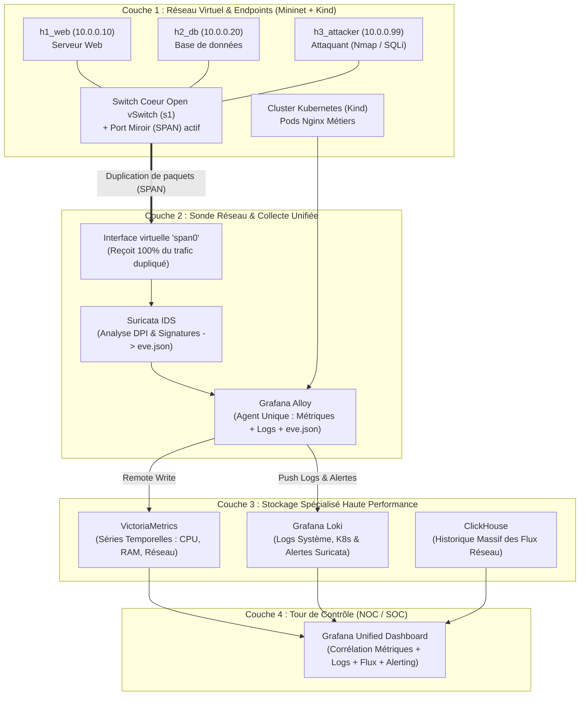

# 🛡️ Architecture de Référence NOC/SOC 360° — Labo Complet (Mininet + Kind + Suricata + Grafana Stack)

Ce dépôt contient l'implémentation complète, pédagogique et reproductible d'une architecture **NOC (Network Operations Center)** et **SOC (Security Operations Center)** moderne en 4 couches.

Il a été spécialement conçu pour tourner sur **une seule machine virtuelle Ubuntu 24.04 LTS** (dans VMware Workstation ou WSL2) avec une empreinte matérielle minimale (**3 vCPU / 8 à 10 Go de RAM**), en combinant :
* **Mininet & Open vSwitch (OVS)** pour simuler le réseau d'entreprise et le **Port Mirroring (SPAN)** matériel.
* **Suricata (IDS)** pour la détection d'intrusions réseau en temps réel sur le port miroir.
* **Kind (Kubernetes in Docker)** pour héberger les microservices métiers.
* **Grafana Alloy + VictoriaMetrics + Loki + ClickHouse + Grafana** pour la collecte unifiée, le stockage haute performance et la corrélation visuelle.

---

## 🏗️ 1. Comprendre l'Architecture (Approche Pédagogique)

Dans un environnement de production, l'observabilité 360° repose sur **4 couches logiques**. Voici comment chaque couche fonctionne dans ce labo et **pourquoi** chaque brique technologique a été choisie :



### Pourquoi ces choix techniques plutôt que les outils classiques ?
1. **Mininet (Open vSwitch) au lieu d'OpenStack complet sur un PC portable :**
   OpenStack utilise *Open vSwitch (OVS)* sous le capot (via son composant Neutron), mais consomme 10 Go de RAM rien que pour ses API de gestion. Avec Mininet, on pilote directement **Open vSwitch** avec 50 Mo de RAM, tout en configurant un vrai **Port Miroir (SPAN)** identique à celui d'un switch Cisco ou d'un cloud OpenStack.
2. **Grafana Alloy au lieu de `Telegraf + Promtail` :**
   Promtail est officiellement en fin de vie (*Deprecated*). Alloy est le nouvel agent unifié de Grafana Labs : un seul binaire collecte à la fois les métriques (comme Telegraf) et les logs/alertes (comme Promtail).
3. **VictoriaMetrics au lieu d'InfluxDB :**
   Compatible à 100 % avec Prometheus et InfluxDB, il consomme **4 fois moins de mémoire vive** et s'intègre nativement avec tous les tableaux de bord Grafana existants.

---

## 📂 2. Structure du Projet

```text
noc-soc-lab/
├── 01-central-stack/                  # Couches 3 & 4 : Stockage et Visualisation
│   ├── docker-compose.yml             # Déploie VictoriaMetrics, Loki, ClickHouse, Alloy et Grafana
│   ├── alloy/config.alloy             # Pipeline de collecte unifié (Métriques + Logs + Suricata)
│   ├── loki/loki-config.yml           # Configuration optimisée de Grafana Loki
│   └── grafana/provisioning/          # Connexion automatique des 3 bases dans Grafana
├── 02-network-mininet/                # Couche 1 : Simulation Réseau & Port Miroir
│   └── topology_noc_soc.py            # Crée le switch OVS, 3 hôtes et le Port Miroir (span0)
├── 03-kubernetes-kind/                # Couche 1 (Cloud-Native) : Cluster Kubernetes
│   ├── kind-config.yaml               # Cluster K8s mono-noeud ultra-léger
│   └── demo-app.yaml                  # Déploiement d'une application web de test
└── 04-sonde-ids/                      # Couche 2 : Sonde de Sécurité (SOC) & Scénarios d'attaque
    ├── setup_probe.sh                 # Script d'installation (Mininet, OVS, Suricata, Kind)
    └── simulate_attacks.sh            # Script de simulation de trafic NOC et d'attaques SOC
```

---

## 🚀 3. Guide de Déploiement Pas-à-Pas (Dans votre VM Ubuntu)

### Étape 1 : Installer les outils sur la VM Ubuntu
Clonez ce dépôt dans votre VM Ubuntu 24.04 LTS et lancez le script d'installation :
```bash
chmod +x 04-sonde-ids/*.sh
./04-sonde-ids/setup_probe.sh
```

### Étape 2 : Démarrer le Serveur Central NOC/SOC (Couches 3 & 4)
```bash
cd 01-central-stack
docker compose up -d
```
* **Grafana** est immédiatement accessible sur `http://<IP_DE_LA_VM>:3000` (Identifiants : `admin` / `admin`).
* Les 3 sources de données (**VictoriaMetrics**, **Loki**, **ClickHouse**) sont **déjà pré-configurées automatiquement** !
* L'interface de débogage visuel de **Grafana Alloy** est visible sur `http://<IP_DE_LA_VM>:12345`.

### Étape 3 : Démarrer le Réseau d'Entreprise et le Port Miroir (Couche 1)
Dans un nouveau terminal sur la VM Ubuntu, lancez la topologie Mininet :
```bash
sudo python3 02-network-mininet/topology_noc_soc.py
```
Ce script crée automatiquement :
* Le switch cœur Open vSwitch `s1`
* Les hôtes `h1_web` (`10.0.0.10`), `h2_db` (`10.0.0.20`) et `h3_attacker` (`10.0.0.99`)
* L'interface miroir `span0` qui duplique 100 % des paquets traversant le switch `s1`.

### Étape 4 : Activer la Sonde Suricata IDS sur le Port Miroir (Couche 2)
Dans un second terminal, lancez Suricata en écoute sur l'interface miroir `span0` :
```bash
sudo suricata -i span0 -D
```
Vous pouvez vérifier en direct que Suricata écoute le trafic du switch :
```bash
sudo tail -f /var/log/suricata/eve.json
```

### Étape 5 : Lancer le Cluster Kubernetes avec Kind (Optionnel - DevOps)
```bash
kind create cluster --config 03-kubernetes-kind/kind-config.yaml
kubectl apply -f 03-kubernetes-kind/demo-app.yaml
kubectl get pods
```

---

## 🎯 4. Tester et Vérifier la Détection d'Attaque (Mise en Situation SOC)

Depuis le terminal interactif `mininet>`, lancez le script d'attaque depuis la machine `h3_attacker` vers le serveur web `h1_web` (`10.0.0.10`) :
```text
mininet> h3_attacker bash 04-sonde-ids/simulate_attacks.sh 10.0.0.10
```

### Ce qui se passe sous le capot (de bout en bout) :
1. `h3_attacker` envoie un scan de ports **Nmap** et une tentative d'injection SQL (`sqlmap`).
2. Le switch **Open vSwitch (`s1`)** transfère les paquets vers `h1_web` **ET** envoie une copie conforme sur le port miroir **`span0`**.
3. **Suricata** analyse les paquets sur `span0`, détecte la signature d'attaque et écrit une alerte JSON dans `/var/log/suricata/eve.json`.
4. **Grafana Alloy** lit cette nouvelle ligne en temps réel et l'expédie vers **Grafana Loki**.
5. Dans **Grafana** (`Menu -> Explore -> Loki`), tapez la requête suivante pour voir vos alertes de sécurité :
   ```logql
   {job="suricata-ids"} |= "alert" | json
   ```
   Et dans `Explore -> VictoriaMetrics`, tapez :
   ```promql
   rate(node_network_receive_bytes_total[1m])
   ```
   pour observer le pic de bande passante réseau au même instant !
